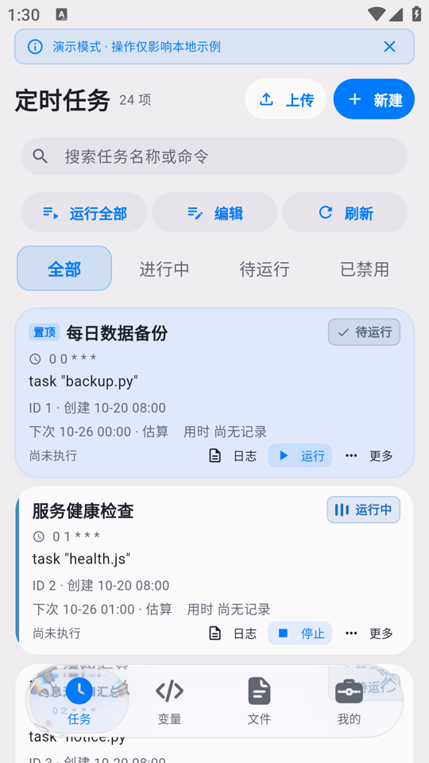
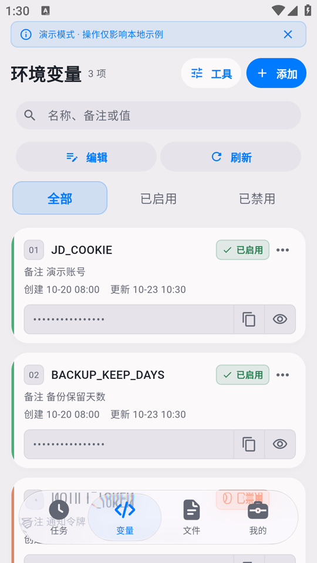
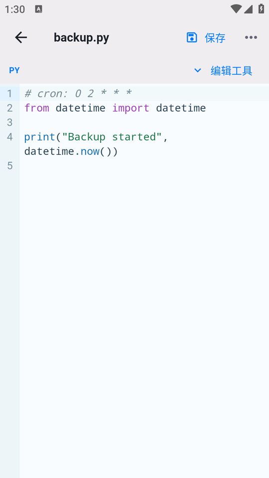
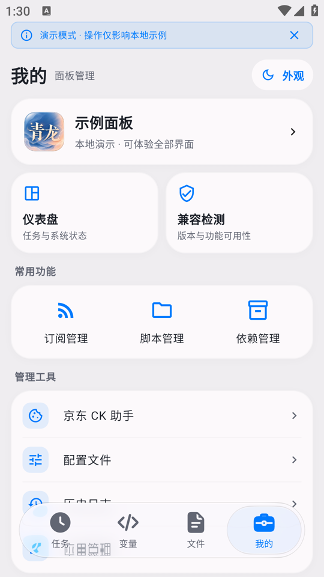

# 青龙掌控 · qinglong-app

基于 Flutter 的青龙面板 Android 管理客户端。连接已有面板，在手机上管理任务、环境变量、脚本和订阅。目前仅支持安卓端，iOS和鸿蒙端请有能力者自行开发

[下载最新版本](https://github.com/muzixing666/qinglong-app/releases/latest) · [所有版本](https://github.com/muzixing666/qinglong-app/releases) · [构建说明](docs/BUILD.md) · [用户协议](docs/USER_AGREEMENT.txt)

## 软件截图

以下截图使用本地演示数据，不包含真实面板账号、密钥或 Cookie。

| 定时任务 | 环境变量 |
| --- | --- |
|  |  |
| 脚本编辑 | 面板管理 |
|  |  |

## 功能

- **任务管理**：运行、停止、启用、禁用、置顶、复制、批量操作、定时预设和日志历史；删除任务时可选择删除对应脚本，共用脚本会保留。
- **环境变量**：序号、启用状态、备注和时间信息，支持拖动排序、按名称分组展开/收起，以及编辑和批量管理。
- **脚本与配置**：语法高亮、自动换行、搜索、跳行、本地与远程上传、剪贴板识别，以及面板支持时的历史对比和恢复；脚本与日志文件支持长按删除确认。
- **订阅与依赖**：订阅配置、分类依赖管理、代理与镜像源设置、缓存清理。
- **面板工具**：仪表盘、兼容检测、应用权限管理、密钥复制、通知设置、日志搜索、清晰的登录记录及账号辅助工具。
- **桌面功能**：图标长按快捷进入任务、变量、脚本和面板管理；原生状态小组件显示任务总数、运行中数量、更新时间，提供刷新与快捷入口。
- **使用体验**：明暗主题、玻璃导航、轻微震动、缓存页面切换、多面板连接；简单配置使用弹窗，常用操作提供轻量反馈；提供本地演示模式。

作者：**Muzixing**

## 开始使用

1. 从 [Releases](https://github.com/muzixing666/qinglong-app/releases) 下载 APK 并安装。
2. 添加已有青龙面板地址，使用面板账号密码或受支持的应用凭据连接。
3. 无面板时可使用本地演示模式体验。

Android 最低版本为 **8.0**。面板功能取决于服务端版本和账户权限，并非所有面板版本都已实测。通过 GitHub 下载的同签名新版可覆盖安装；请保留重要脚本和配置备份。

## 开发与许可

当前版本 **0.22.1**。本版修复任务编辑保存，并优化上传分区、变量拖动分组、简单配置弹窗和登录记录。构建步骤见 [docs/BUILD.md](docs/BUILD.md)。仓库不包含发行密钥、面板连接资料或测试账户。

项目按 [GPL-3.0](LICENSE) 发布，第三方组件的版权及许可说明随对应源码与许可文件保留。

反馈问题请使用 [Issues](https://github.com/muzixing666/qinglong-app/issues)，提交前移除密码、密钥、Cookie 和令牌。
